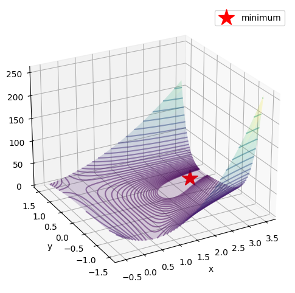
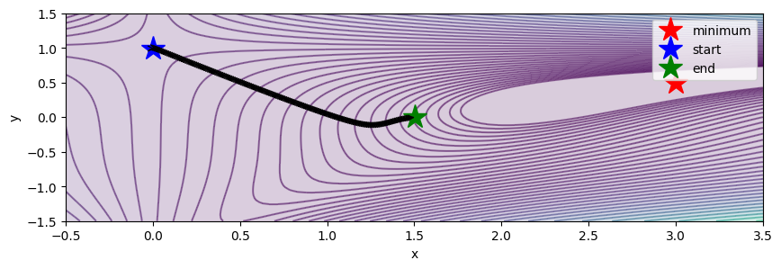

# Optimisation Algorithms for Deep Learning, from Scratch

Implementations of the main **first- and second-order optimisers** used in deep learning, and a visual comparison of how each one moves across hard non-convex test surfaces.

<p align="center">
  
  
</p>

## Optimisers implemented

| Method | Idea |
|---|---|
| Gradient descent | Fixed step along the negative gradient |
| Momentum | Accumulates velocity to move through flat regions and dampen oscillation |
| RMSProp | Per-parameter step sizes scaled by a running average of squared gradients |
| Adam | Momentum plus adaptive scaling, with bias correction |
| Newton's method | Second-order steps using the Hessian |

## Experiments

- Standard optimisation test functions with flat valleys and many local minima (Ackley, Beale)
- Trajectories of each optimiser from the same starting point, plotted on the loss contours
- Comparison of convergence speed, overshooting and trapping in local minima across methods

## Files

```
optimizers_from_scratch.ipynb   # implementations, test functions, trajectory plots
figures/                        # selected figures exported from the notebook
```

## Run

```bash
pip install numpy matplotlib torch
```
