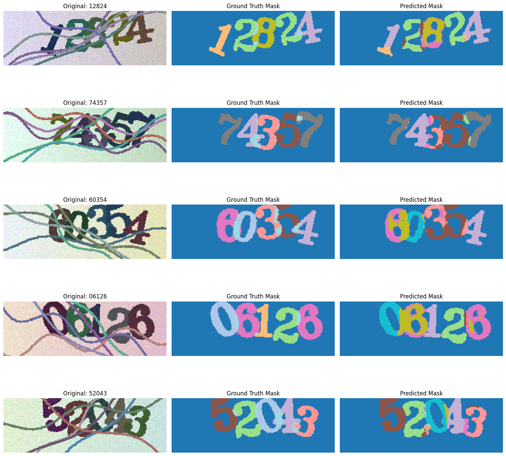
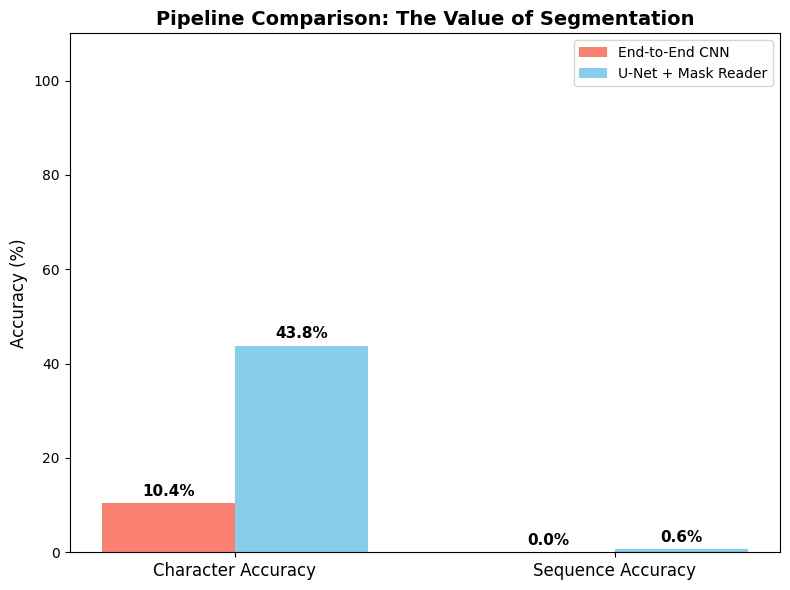

# CAPTCHA Reading with U-Net Segmentation

A two-stage pipeline for reading distorted five-digit CAPTCHAs. A compact **U-Net** first separates overlapping characters from noise and background; a CNN with parallel output heads then reads the sequence from the predicted masks. Its performance is compared with an end-to-end CNN that reads the raw image directly.

<p align="center">
  
  
</p>

## Pipeline

| Stage | Details |
|---|---|
| **Data** | Synthetic CAPTCHA generator with overlapping digits, interference lines and colour noise; pixel-level masks come for free |
| **Segmentation** | `MicroUNet`: encoder–decoder with skip connections, trained for per-pixel character classes |
| **Recognition** | CNN with five parallel softmax heads, one per character position, applied to the masks |
| **Baseline** | The same reader trained end-to-end on raw images |

## Results (500 unseen CAPTCHAs, short training budget)

| Pipeline | Character accuracy |
|---|---|
| End-to-end CNN | 10.4% |
| **U-Net + mask reader** | **43.8%** |

Segmentation quadruples character-level accuracy under the same small training budget, which shows how much the separation step helps. Full-sequence accuracy remains low at this budget, since all five characters must be right at once. Longer training of the reader is the natural next step.

## Files

```
captcha_unet_segmentation.ipynb   # data generation, U-Net, reader, evaluation
figures/                          # selected figures exported from the notebook
```

## Run

```bash
pip install torch opencv-python numpy matplotlib tqdm
```
