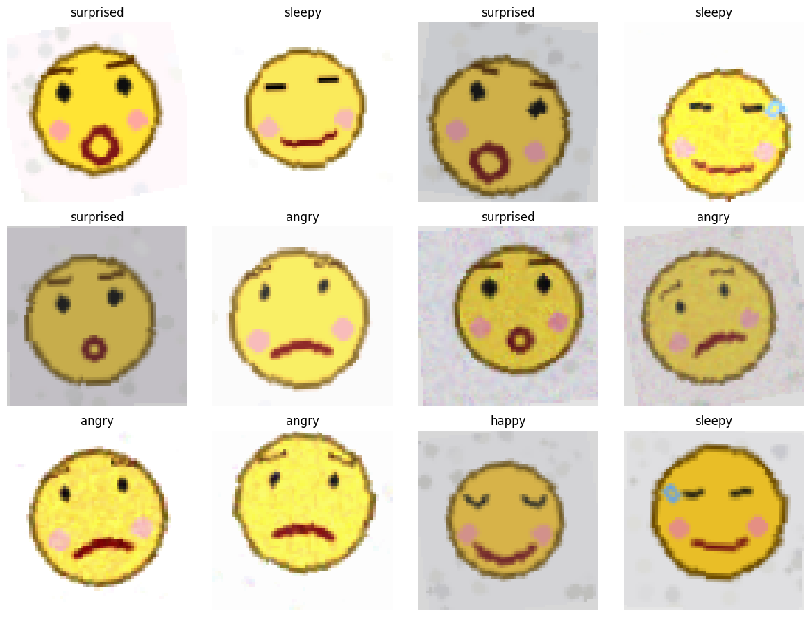
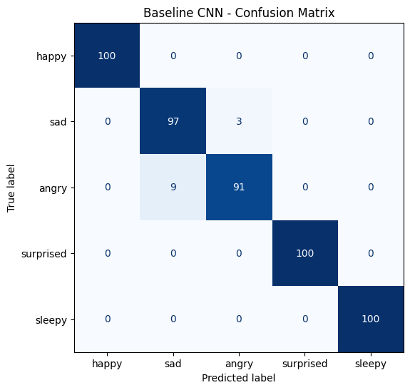
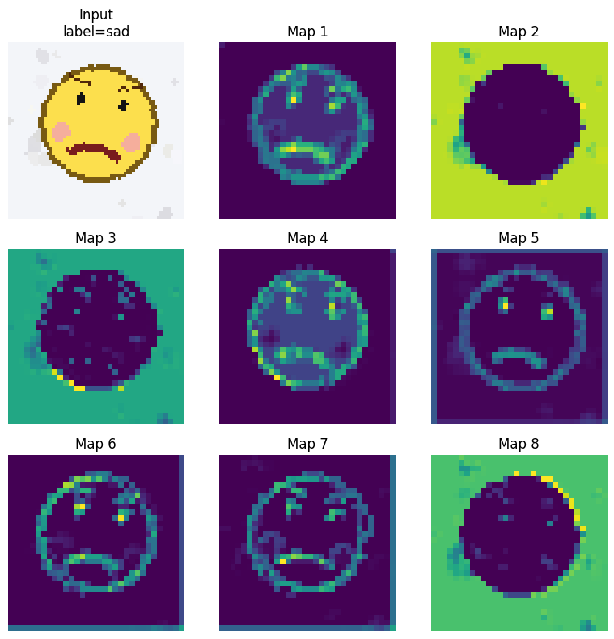

# Convolutional Networks from Scratch: Emoji Expression Classification

A CNN designed and trained **from scratch** to recognise five facial expressions (happy, sad, angry, surprised, sleepy) in emoji images that are rotated, shifted and noisy. The project covers the full workflow: building the dataset, augmentation, architecture design, training, error analysis and feature-map visualisation, ending with an efficiency-oriented redesign.

<p align="center">
  
  
  
</p>

## Pipeline

| Stage | Details |
|---|---|
| **Data** | Programmatically generated emoji dataset, 5 balanced classes, train/val/test split (500 test images) |
| **Augmentation** | Random resized crop, rotation, horizontal flip, colour jitter and Gaussian blur (training only) |
| **Baseline CNN** | Three convolutional blocks (conv → batch norm → ReLU → max-pool) and a fully connected head; 2.2 M parameters |
| **Training** | Custom `train_one_epoch` / `evaluate` loops with loss and accuracy tracking |
| **Analysis** | Confusion matrix, inspection of misclassified images with confidences, first-block feature maps |
| **Redesign** | A compact CNN (0.6 M parameters, 3.6× fewer): double-convolution blocks, spatial dropout and global average pooling |

## Results (test set)

| Model | Parameters | Accuracy | Macro F1 |
|---|---|---|---|
| **Baseline CNN** | 2.21 M | **97.6%** | 0.976 |
| Compact CNN | 0.62 M | 94.6% | 0.945 |

Almost all errors come from **sad ↔ angry** confusion. The two classes differ mainly in the shape of the eyebrows, a few pixels wide, which augmentation can blur. The compact model keeps perfect accuracy on the other three classes but loses more on this pair, a clear accuracy–capacity trade-off discussed in the notebook's closing analysis.

## Files

```
cnn_emoji_classification.ipynb   # data, augmentation, models, training, evaluation, analysis
figures/                         # selected figures exported from the notebook
```

The notebook's explanations and discussion are written in Persian; code, outputs and figures follow standard conventions.

## Run

```bash
pip install torch torchvision scikit-learn matplotlib pillow
```
