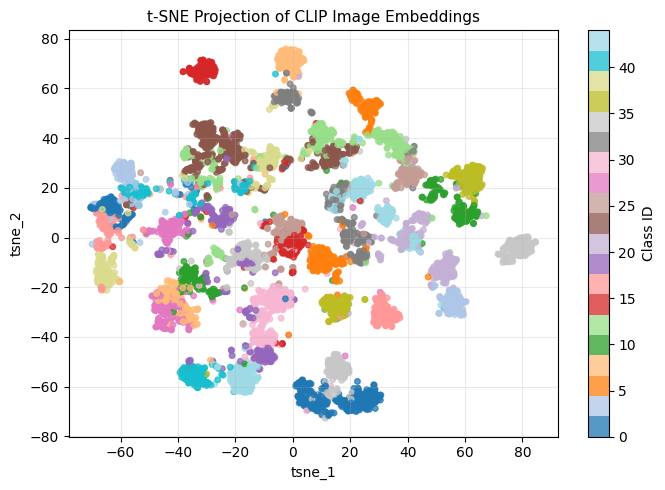
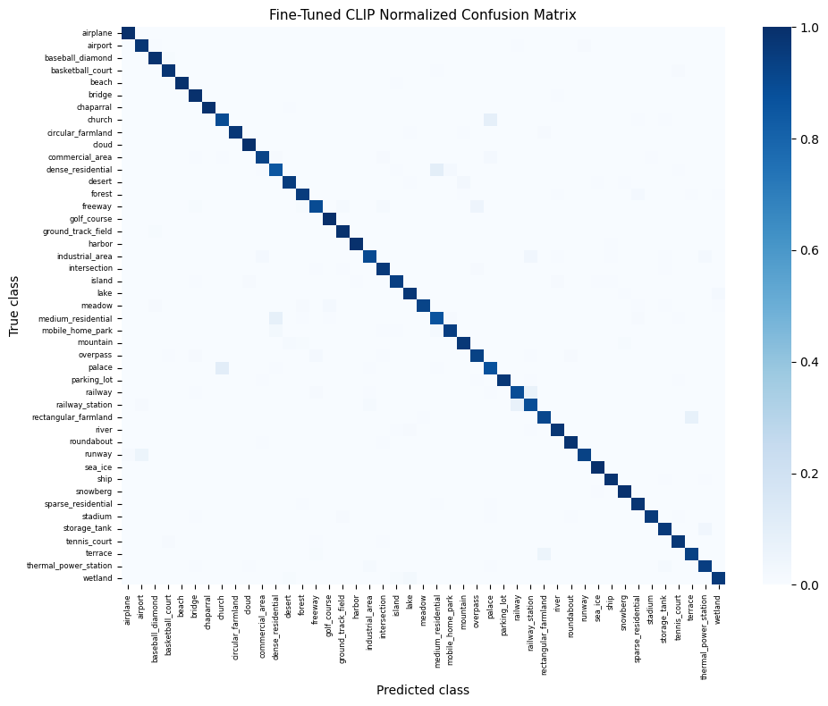

# CLIP for Satellite Imagery: Zero-Shot Analysis and LoRA Fine-Tuning

A systematic study of **CLIP** on remote-sensing imagery (RESISC45: 45 land-use classes, 31,500 images). It covers zero-shot classification, prompt engineering, embedding-space analysis, error analysis, and parameter-efficient fine-tuning with LoRA.

<p align="center">
  
  
</p>

## Main result

| Model | Top-1 accuracy | Recall@5 |
|---|---|---|
| Zero-shot CLIP ("a satellite image of a {}") | 67.8% | 94.8% |
| **CLIP + LoRA fine-tuning** | **95.3%** | **99.9%** |

Fine-tuning with low-rank adapters raises top-1 accuracy by 27.5 points on the full 6,300-image test set while training only a small fraction of the parameters.

## Analyses

- **Zero-shot classification** with per-class accuracy, the most confident correct and incorrect predictions, and the confusion matrix
- **Prompt engineering**: nine prompt templates and several prompt ensembles compared, with per-class accuracy across templates
- **Embedding geometry**: PCA and t-SNE of image embeddings, class centroids, and where zero-shot errors sit in embedding space
- **Text-to-image retrieval** from natural-language queries
- **LoRA fine-tuning** of CLIP ViT-L/14 (adapters on the attention projections q, k, v, out), and a comparison of Stable Diffusion outputs using the base vs fine-tuned text encoder

## Files

```
clip_vision_analysis.ipynb   # setup, zero-shot, prompts, embeddings, retrieval, LoRA
figures/                     # selected figures exported from the notebook
```

## Run

```bash
pip install torch transformers datasets peft scikit-learn matplotlib seaborn
```

The model and dataset are loaded from the Hugging Face Hub (`openai/clip-vit-large-patch14`, `timm/resisc45`). A GPU is required for fine-tuning.
