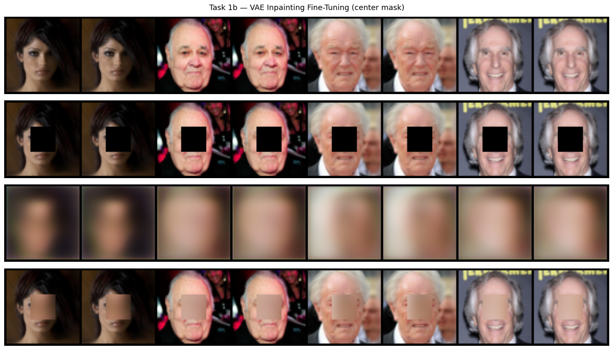
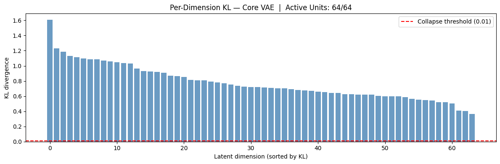

# Variational Autoencoders on CelebA-HQ: Inpainting, Posterior Collapse and Latent Editing

A convolutional **variational autoencoder** trained on CelebA-HQ faces, fine-tuned for **image inpainting**, and analysed in depth: posterior-collapse diagnostics, latent-space geometry, and attribute manipulation.

<p align="center">
  
  
</p>

## What is built

| Part | Details |
|---|---|
| **Data** | CelebA-HQ images with 40 binary attributes; attribute frequency and correlation analysis |
| **Core VAE** | Convolutional encoder–decoder (5.1 M parameters, 64-dim latent) with residual and skip-fusion blocks |
| **Training** | β-annealing of the KL term with a free-bits floor to prevent posterior collapse |
| **Inpainting** | Fine-tuning with four mask types (centre, eyes, mouth, scattered); loss weighted toward the missing region |
| **Diagnostics** | Active-unit counting, per-dimension KL, aggregate-posterior statistics vs the N(0, I) prior |
| **Latent space** | t-SNE coloured by attributes, nearest neighbours, PCA eigenvalue decay, prior vs posterior sampling, interpolation, attribute vectors |

## Findings

- **No posterior collapse:** all 64 latent dimensions stay active (KL > 0.01 nats each); total KL is 49.6 nats per sample
- **The latent space has a low intrinsic dimension**: PCA shows a fast eigenvalue decay
- Good reconstruction latents and good *generative* latents are not the same thing. Samples drawn from the prior are blurrier than reconstructions because the aggregate posterior does not fill the prior's shell — a classic VAE limitation discussed in the notebook
- Attribute directions (smiling, eyeglasses) can be added to latent codes for controlled edits

## Files

```
vae_celeba_inpainting.ipynb   # configuration, data, models, training, diagnostics, latent analysis
figures/                      # selected figures exported from the notebook
```

## Run

```bash
pip install torch torchvision gdown matplotlib scikit-learn seaborn
```

CelebA-HQ is downloaded by the notebook; a GPU is recommended.
