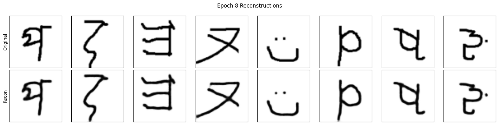
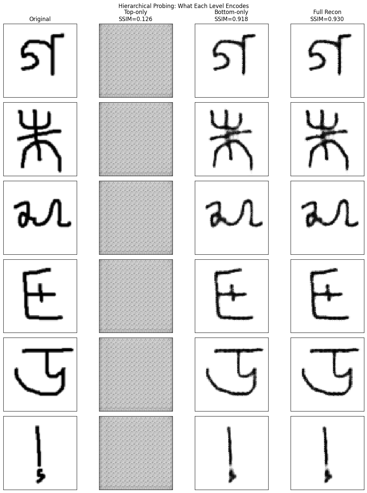

# VQ-VAE-2 on Omniglot: Learning a Discrete Visual Alphabet

A two-level **VQ-VAE-2** (Razavi et al., 2019) trained on Omniglot handwritten characters. Images are compressed into discrete codes from learned codebooks, a top level for global structure and a bottom level for detail, and the project examines what each level of the hierarchy has learned.

<p align="center">
  
  
</p>

## Implementation

| Component | Details |
|---|---|
| **Vector quantiser** | Codebook updated by exponential moving average, straight-through gradient estimator, commitment loss |
| **Hierarchy** | Top latent grid 8×8 (global shape) and bottom latent grid 16×16 (stroke detail) |
| **Model size** | 0.9 M trained parameters plus 33 K codebook entries updated by EMA |
| **Initialisation** | Codebooks initialised from real encoder outputs to reduce dead codes |

## Results

| Metric | Value |
|---|---|
| Reconstruction SSIM | 0.987 (training) / 0.930 (full model on held-out images) |
| FID of reconstructions | 21.6 |

**Hierarchy ablation (SSIM):**

| Decoder input | SSIM |
|---|---|
| Both levels | 0.930 |
| Bottom level only | 0.918 |
| Top level only | 0.126 |

On these small, simple images the bottom level carries almost all the information. The top codebook is barely used (perplexity ≈ 1.5), a form of codebook under-utilisation that the notebook analyses through code-usage distributions and the image patches that activate each code most strongly.

## Files

```
vqvae2_omniglot.ipynb   # quantiser, model, training, evaluation, codebook analysis
figures/                # selected figures exported from the notebook
```

The notebook uses a reduced configuration so it runs on a single consumer GPU. The changes are explained in its opening section.

## Run

```bash
pip install torch torchvision scipy scikit-image matplotlib
```

## Reference

Razavi, A., van den Oord, A., and Vinyals, O. (2019). Generating Diverse High-Fidelity Images with VQ-VAE-2. *NeurIPS*.
