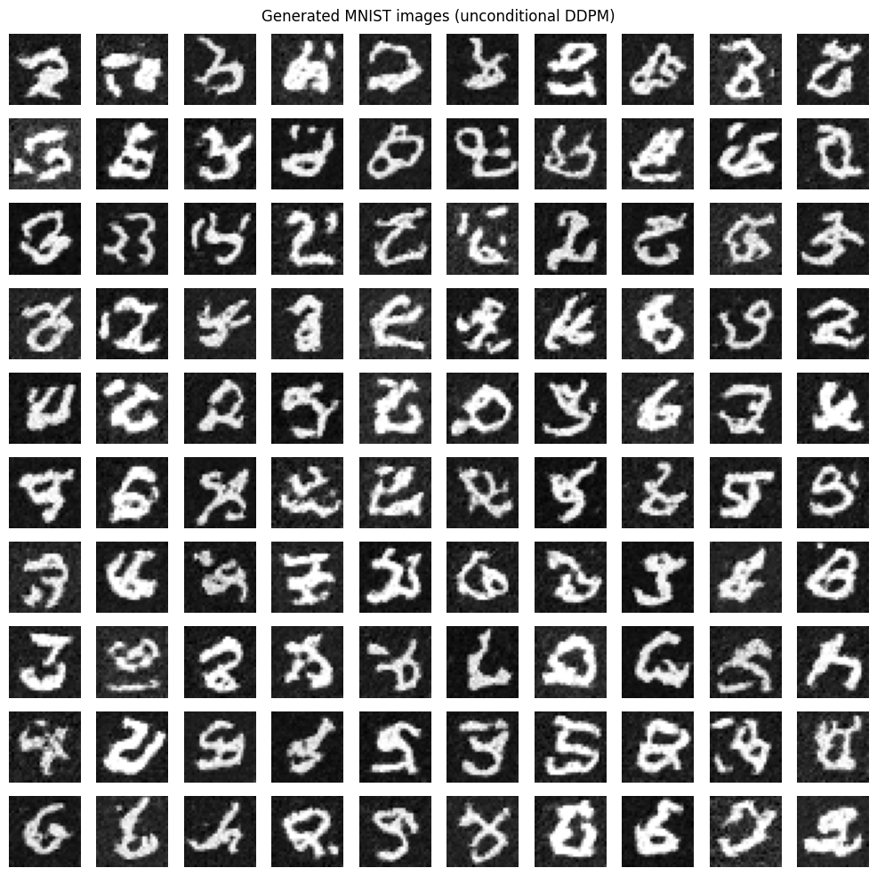
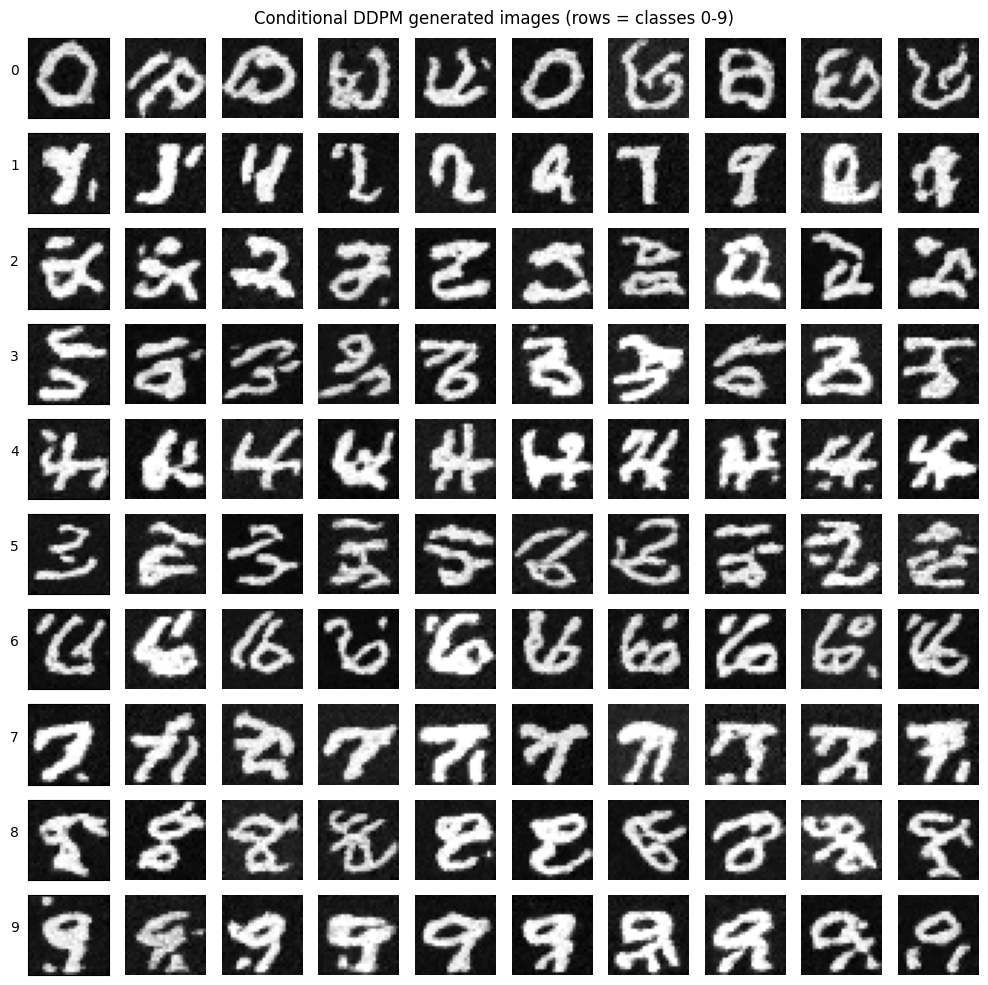

# Denoising Diffusion Probabilistic Models from Scratch

A complete **DDPM** (Ho et al., 2020) implementation in PyTorch, including the U-Net denoiser, noise schedule, forward and reverse processes and sampling. It is trained to generate MNIST digits and then extended to **class-conditional generation with classifier-free guidance**.

<p align="center">
  
  
</p>

## Implementation

| Component | Details |
|---|---|
| **U-Net** | Residual blocks with time embedding, multi-head self-attention, down/up-sampling paths with skip connections |
| **Time embedding** | Sinusoidal timestep embeddings injected into every residual block |
| **Diffusion** | Variance schedule, closed-form forward noising, learned reverse denoising, ancestral sampling |
| **Conditional model** | Joint timestep and class embeddings, classifier-free guidance (training with label dropout, guided sampling) |
| **Evaluation** | A lightweight PCA-feature Fréchet distance between real and generated digits |

## Results and limitations

Both models were trained for only 3 epochs because of compute limits; the denoising loss falls from 0.155 to 0.071. The samples show digit-like strokes, and the conditional model already places a recognisable class in each row, but quality is well below a fully trained DDPM. The low-cost Fréchet score (220) is meant only for comparing runs of this setup. Longer training is the obvious next step.

## Files

```
ddpm_mnist.ipynb   # U-Net, diffusion process, training, sampling, conditional model, evaluation
figures/           # sample grids exported from the notebook
```

## Run

```bash
pip install torch torchvision matplotlib scipy
```

## Reference

Ho, J., Jain, A., and Abbeel, P. (2020). Denoising Diffusion Probabilistic Models. *NeurIPS*.
