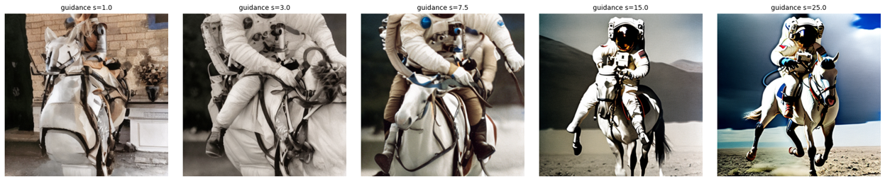
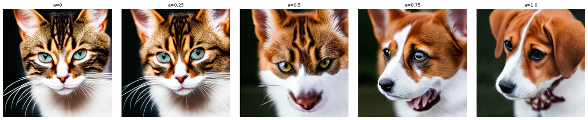

# The Mechanics of Diffusion-Based Image Editing

A hands-on dissection of **Stable Diffusion**. Instead of calling a single pipeline, the notebook opens up each component — the VAE latent space, the noise schedule, the reverse sampler, classifier-free guidance and CLIP text conditioning — and ends with instruction-based editing and inpainting.

<p align="center">
  
</p>
<p align="center"><em>Classifier-free guidance sweep (s = 1, 3, 7.5, 15, 25): prompt adherence rises with s, and so do over-saturation and artefacts.</em></p>

## Experiments

| Part | What is measured |
|---|---|
| **Latent space** | 48× compression from pixels (3×512×512) to latents (4×64×64); VAE round-trip quality (PSNR 25.7 dB) |
| **Forward process** | A latent dissolving into noise across timesteps; the ᾱₜ schedule and log signal-to-noise ratio |
| **Reverse process** | A hand-written DDIM sampling loop; image quality vs number of steps (4, 10, 25, 50) and run time |
| **Guidance** | Sweep of the classifier-free guidance scale with a fixed prompt and seed |
| **Conditioning** | Cosine similarity of CLIP prompt embeddings; interpolation between two prompts in embedding space |
| **Applications** | Iterative instruction editing with InstructPix2Pix; inpainting and why its U-Net takes 9 input channels |
| **Failure analysis** | A failed generation explained through the mechanism behind it (excessive guidance) |

<p align="center">
  
</p>
<p align="center"><em>Interpolating between the CLIP embeddings of two prompts (α = 0 → 1) moves the image smoothly from one concept to the other.</em></p>

## Files

```
diffusion_image_editing.ipynb   # all parts, with outputs
figures/                        # selected figures exported from the notebook
```

## Run

```bash
pip install torch diffusers transformers accelerate matplotlib
```

Requires a GPU and a Hugging Face account to download the models.
