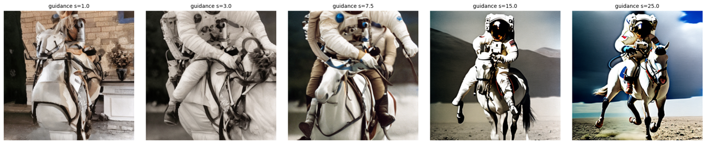

# Deep Learning Projects

Twelve deep-learning projects in **PyTorch**, ordered from first principles to current generative models: building networks and optimisers from scratch, then CNNs, RNNs, self-supervised and multimodal learning, parameter-efficient fine-tuning of LLMs, and three families of generative models (VAEs, VQ-VAEs and diffusion).

  

## Projects

### Foundations

| # | Project | Highlights |
|---|---|---|
| 01 | [PyTorch fundamentals](01-pytorch-fundamentals) | Tensors, broadcasting, GPU, data loaders; MLP on MNIST with t-SNE of activations |
| 02 | [Neural-network framework from scratch](02-neural-network-from-scratch) | NumPy layers with analytic backprop and gradient checks; SGD, momentum, RMSProp, Adam; California Housing regression |
| 03 | [Optimisation algorithms](03-optimization-algorithms) | GD, momentum, RMSProp, Adam and Newton's method compared on non-convex test surfaces |

### Architectures

| # | Project | Highlights |
|---|---|---|
| 04 | [CAPTCHA reading with U-Net](04-captcha-segmentation-unet) | U-Net segmentation + multi-head CNN reader; 4× the character accuracy of an end-to-end CNN |
| 05 | [RNNs and LSTMs on IMDB](05-rnn-sentiment-imdb) | Built-in and from-scratch RNN/LSTM cells; LSTM 85.7% test accuracy |

### Representation learning and foundation models

| # | Project | Highlights |
|---|---|---|
| 06 | [SimCLR self-supervised learning](06-simclr-self-supervised) | NT-Xent loss from scratch; linear probe 62.8% top-1 / 97.3% top-5 on STL-10 |
| 07 | [CLIP for satellite imagery](07-clip-vision-analysis) | Zero-shot 67.8% → **95.3%** top-1 on RESISC45 with LoRA; prompt engineering and embedding analysis |
| 08 | [QLoRA fine-tuning of an LLM](08-llm-finetuning-qlora) | Qwen2.5-0.5B in 4-bit with LoRA; rank ablation; task-specialised adapters for GSM8K, CommonsenseQA and AG News |

### Generative models

| # | Project | Highlights |
|---|---|---|
| 09 | [VAE on CelebA-HQ](09-vae-celeba-inpainting) | Inpainting, posterior-collapse diagnostics (64/64 active units), latent attribute editing |
| 10 | [VQ-VAE-2 on Omniglot](10-vq-vae-2-omniglot) | EMA codebooks, two-level hierarchy; reconstruction FID 21.6; hierarchy ablation |
| 11 | [DDPM from scratch](11-ddpm-mnist) | U-Net with attention and time embeddings; unconditional and classifier-free-guided conditional generation |
| 12 | [Diffusion-based image editing](12-diffusion-image-editing) | Stable Diffusion dissected: latent space, schedules, DDIM, guidance, CLIP conditioning, InstructPix2Pix, inpainting |

Each folder has its own README with the method, results, figures and run instructions.

## Stack

PyTorch · torchvision · Hugging Face Transformers, Diffusers, PEFT and Datasets · bitsandbytes · NumPy · scikit-learn · Matplotlib

## Context

These projects were completed for the graduate **Deep Learning** course at Sharif University of Technology (Dr. M. Soleymani Baghshah, 2025–2026). Each started from a course assignment scaffold, with the problem statement and some helper code written by the course staff. The model implementations, training runs, experiments and written analyses are my own. Some discussion answers in the notebooks are written in Persian.

---
**Shayan Pourmasoomi** · MSc Economics, Sharif University of Technology · [GitHub](https://github.com/Shayanpourmasoomi) · [LinkedIn](https://www.linkedin.com/in/shayan-pourmasoomi-8b6206389)
